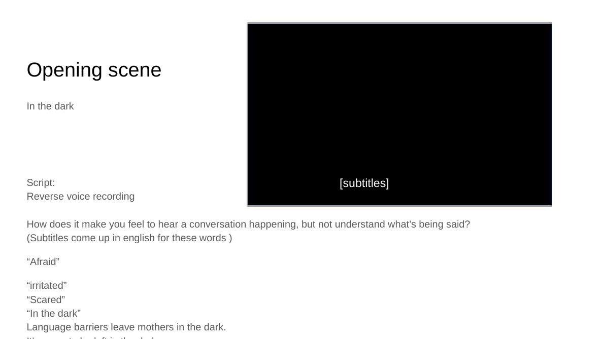
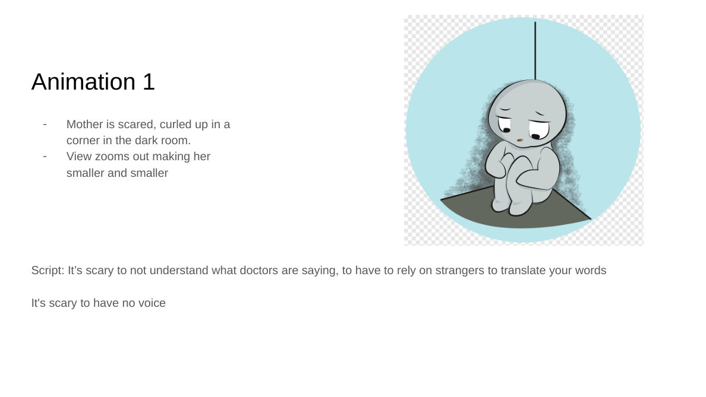
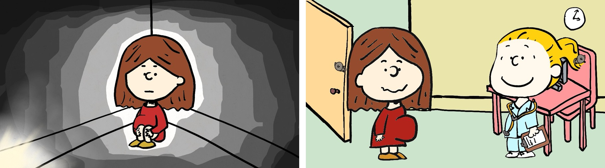
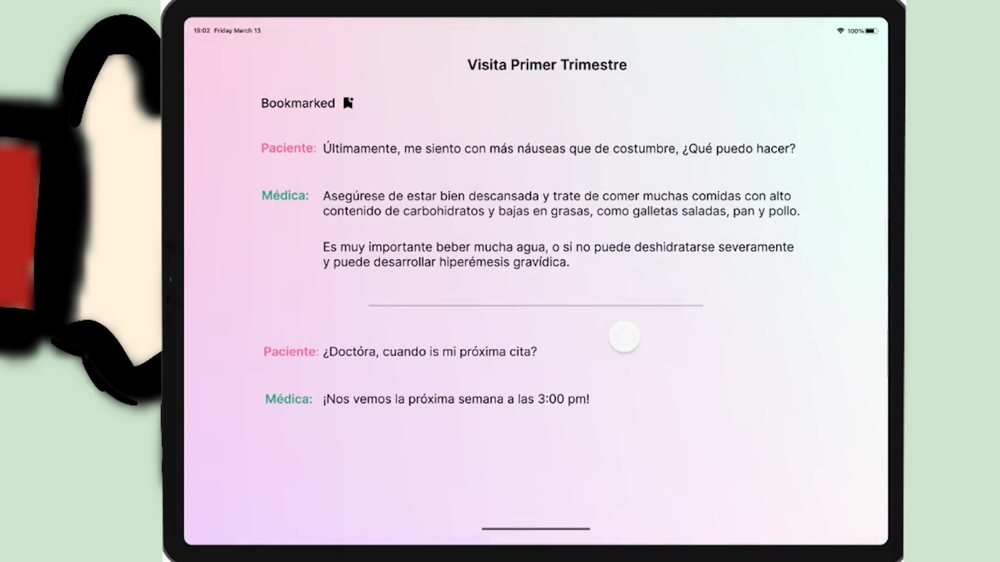

# Lumo — Helping Mothers Be Heard in Healthcare

**2022 · Human-centered design concept · Collaborative team project**  
**My role:** Storyboarding and video production  
**Team:** Maya Joseph, Brygitte De La Cruz, Tiffany Chen, Katherine Ju, Yicheng (Rico) Li

[Watch the final team video](https://youtu.be/TUtkYGcVBCk) · [Explore the interactive Figma prototype](https://www.figma.com/proto/u36ZD4vPvIeuyycDGgbgHn/Prototype?node-id=103%3A41&scaling=scale-down&page-id=0%3A1&starting-point-node-id=103%3A41&show-proto-sidebar=1)

## Project overview

**The challenge:** How might we support non-English-speaking mothers in understanding and participating in prenatal and postpartum healthcare conversations without diminishing the personal nature of clinical care?

Lumo was a **proposed**, tablet-supported translation and conversation-review experience. The team's research emphasized difficulties asking follow-up questions, involving third-party interpreters in sensitive conversations, and remembering important information afterward. The proposed concept included live translated transcripts, bookmarking, and consent-based retention.

## My role and contributions

**I contributed to the project's storyboarding and video production.** I helped communicate the experience of language barriers through a visual narrative, moving from isolation and confusion to the brighter, more understandable interaction envisioned by Lumo.

The storyboards and final video were collaborative deliverables. I do not claim sole authorship of the research, interface prototypes, or broader design decisions.

## Design process

1. **Understand the context — team research.** The team conducted exploratory interviews with mothers and consulted an OB-GYN to examine communication challenges in healthcare.
2. **Explore alternatives — team ideation.** Concepts included a live progress screen, a translation/emotion communication application, and a service-based interpretation alternative.
3. **Prototype and gather feedback — team iteration.** Feedback informed a concept combining translated conversation with accessible records of important information.
4. **Tell the story — my contribution.** Storyboard development and video production communicated the problem and proposed experience through a coherent narrative.

[Read the detailed team design-process summary](design-process.md)

## Visual evidence

### 01 · The language barrier

*Original storyboard slide. An opening scene sets up the feeling of hearing a conversation without understanding it.*

### 02 · Isolation and loss of voice

*Original storyboard slide. A small figure and dark surroundings express the emotional impact of being unable to participate in a conversation.*

### 03 · From darkness to light

*Stills from the final team video, corresponding to the transition planned in storyboard Animation 5. These are **video frames**, not drawings from the text-only storyboard slide.*

### 04 · Reviewing key information

*Still from the final team video illustrating the proposed transcript-bookmarking concept in Animation 9. This is a concept demonstration, not a deployed product.*

**Storytelling rationale:** The recurring **“in the dark → into the light”** motif creates a visible emotional arc, while the final interaction frame shows the feature that is meant to help patients revisit information after a conversation.

[Original storyboard slides](Storyboards/Storyboard%21%21%21.pptx) · [Storyboard notes](Storyboards/Storyboard%20Notes_.docx) · [Final video](https://youtu.be/TUtkYGcVBCk)

## Outcome and limitations

The team communicated a proposed concept through storyboards, prototypes, and a final video. **Lumo was not clinically deployed or validated.** Translation accuracy, interpreter integration, consent, privacy, clinical safety, and accessibility require further study. The visual narrative illustrates the design intention, not measured improvements in healthcare outcomes.

## Project archive

| Folder | Contents |
| --- | --- |
| [Recordings](Recordings/) | Audio and voiceover production files |
| [Interviews Conducted](Interviews%20Conducted/) | Team interview and prototype-feedback documents |
| [Prototypes](Prototypes/) | Three Prototypes and Prototype Story presentations |
| [Storyboards](Storyboards/) | Storyboard slides, scripts, and notes |
| [Research and Planning](Research%20and%20Planning/) | Process documentation and stakeholder assessment |
| [Meetings and Planning](Meetings%20and%20Planning/) | Team meeting notes |
| [Presentations](presentations/) | Early-stage presentation files |

Additional large presentations in the [original project repository](https://github.com/tchen3142/IEME4200FinalProject/tree/main/projects/lumo/presentations) remain available there.

**Privacy and attribution:** These are team materials. Some archived interviews identify participants; do not treat them as anonymized or redistribute their contents without reviewing consent.

**Team credit:** Maya Joseph, Brygitte De La Cruz, Tiffany Chen, Katherine Ju, Yicheng (Rico) Li. Tiffany's confirmed contributions: **storyboarding and video production**.
