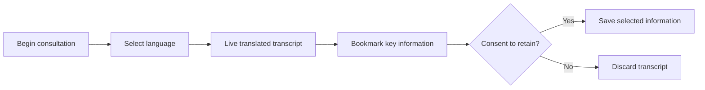

# Lumo — Design Process and Research Summary

*Source: team's 2022 Process Documentation presentation. This is a synthesized, publication-safe summary, not a verbatim transcript of private interviews.*

## 1. Explore the problem
The course brief was **Design for Mothers**. The team conducted exploratory interviews with mothers and spoke with an OB-GYN, focusing on how language barriers affect communication during prenatal and postpartum appointments.

Recurring needs included less time spent requesting interpretation, clearer opportunities to ask follow-up questions, discretion in intimate care, and a way to revisit information.

## 2. Map stakeholders
- **Patients:** Mothers whose preferred language is not English
- **Clinical teams:** Obstetricians, nurses, and medical interpreters
- **Organizations:** Hospitals providing language-access services

## 3. Generate alternatives
The team compared three initial directions:

| Concept | Idea |
|---|---|
| Live progress screen | Display hospital-care information visibly during visits |
| Emotion communication application | Translate conversation into text and help communicate feelings |
| Student interpreter program | Explore certified pre-medical students supporting interpretation |

## 4. Prototype and collect concept feedback
Early feedback highlighted the appeal of seeing doctors' words translated automatically and being able to consult important information later. The team combined aspects of the live progress screen and translation concept.

## 5. Final proposed experience

[Lumo interactive Figma prototype](https://www.figma.com/proto/u36ZD4vPvIeuyycDGgbgHn/Prototype?node-id=103%3A41&scaling=scale-down&page-id=0%3A1&starting-point-node-id=103%3A41&show-proto-sidebar=1) (link sourced from slide 15 of the team's process documentation; external access has not been independently verified).

## 6. Design critique and next tests
The class raised questions about generic translation apps, emotional connection, privacy, and recording consent. Before real clinical deployment, the solution would require qualified interpreter workflows, translation accuracy assessment, safety analysis, patient/clinician consent, and accessibility testing.

**Evidence boundary:** Class feedback supports concept iteration, not clinical effectiveness.
