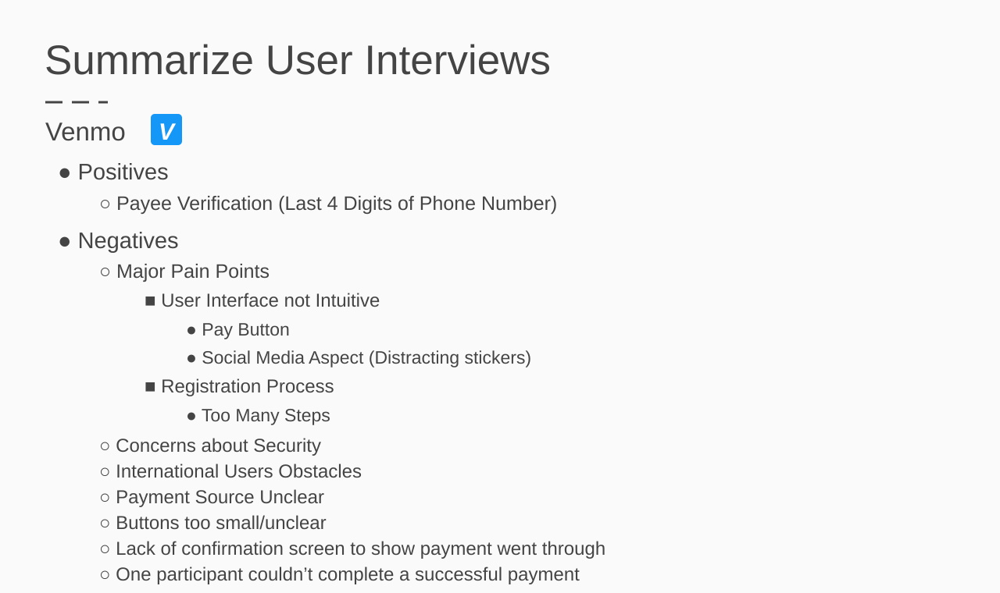
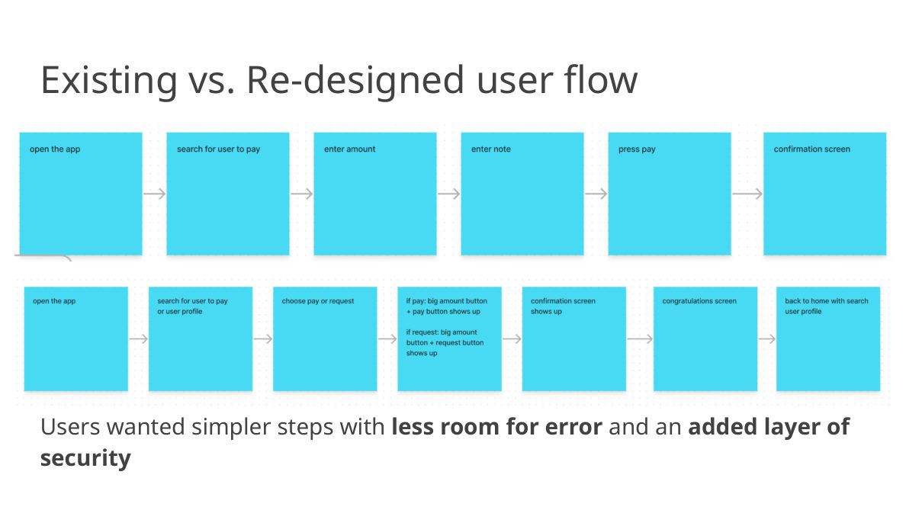
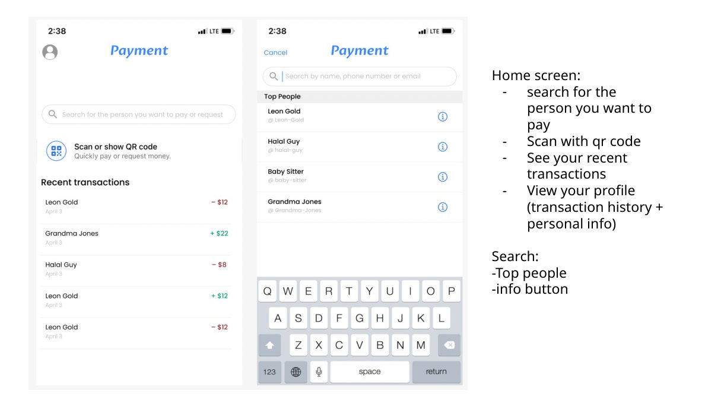

# Payment App Redesign — Making Digital Payments More Accessible

**User-centered design concept · 2022 · Team project**

**Team:** Alexandrea Jee, Cindy Espinosa, Lord Crawford, Naina Durga, Tiffany Chen

## My role & contributions — Tiffany Chen

**My confirmed contributions: User interviews and usability testing.**

I contributed to the team's user research by interviewing participants and observing how they interacted with contactless payment applications. This work helped document usability concerns encountered during account setup and payment tasks.

The findings and proposed redesign below represent the **team's collective work**. I do not claim sole authorship of the interface designs, final recommendations, or any measured improvement.

**Related artifacts:** [Usability Test Plan](../../Seminar%20in%20Human%20Factor%20Design/Usability%20Test%20Plan%20%283-21-2022%29.docx) · [Final team presentation](../../Seminar%20in%20Human%20Factor%20Design/Final%20Redesign%20Presentation.pptx)

## From user interviews to design opportunities

My contribution focused on **user interviews and usability testing**. Through participant conversations and observations of contactless-payment tasks, I helped document where users experienced confusion or hesitation. The team's findings informed the design opportunities explored below.

### Research evidence — Venmo interview findings

*Readable recreation of slide 4 in the [original team presentation](../../Seminar%20in%20Human%20Factor%20Design/Final%20Redesign%20Presentation.pptx). The text reflects the original slide, but the layout and logo placement have been corrected for legibility. It is not an unmodified original screenshot.*

The team identified several usability concerns: difficulty locating the **Pay** action, distracting social features, too many registration steps, unclear payment sources, security concerns, and missing transaction confirmation. The same slide also notes an existing positive feature: verifying a payee using the last four digits of a phone number.

### Translating findings into design considerations

| Research observation | Design opportunity |
| --- | --- |
| Users struggled to find the Pay action | Make the primary payment path easier to discover |
| Users were unsure which balance or account would be charged | Show the selected funding source at the point of payment |
| Users worried about errors and payment completion | Offer a clear review step and completion feedback |
| Registration and verification presented obstacles | Make required steps and account status easier to understand |

These are **design opportunities**, not claims that the proposed changes were tested successfully or delivered measurable improvements.

### Team design exploration

**Existing versus proposed flow**

*The team explored alternate steps and checks in the payment process. This represents collaborative design work.*

**Home and contact search**

*Concept screens explore payment-action visibility and contact discovery; they are not attributed to my individual design work.*

**Confirmation and completion**

*The proposed confirmation and success screens illustrate how the team sought to address uncertainty when sending money.*

**Attribution and limitations:** My confirmed contributions were user interviews and usability testing. The research synthesis, flow revisions, and prototype screens are credited to the broader team. The presentation describes proposed future validation, but does not establish improved task-completion rates or other post-redesign outcomes.

## The challenge

How might we reduce confusion, error anxiety, and navigation friction for older adults and people less familiar with contactless payment applications?

The project investigated existing experiences in **Venmo, Zelle, and Cash App** before proposing a simpler payment flow.

## Research context

The team documented interview feedback and usability observations. Concerns appearing across the research included:
- Difficulty finding the pay action
- Uncertainty about the funding source
- Risk of paying the wrong person or sending the wrong amount
- Distracting social content and unnecessary controls
- Friction in sign-up and bank verification, especially for users outside the US
- Insufficient transaction confirmation

The research also recognized benefits in existing services, such as Zelle's bank integration and Venmo's payee verification.

## Proposed experience

The team mapped an existing payment flow and explored a redesigned one with:
1. **Home screen:** Search people, scan a QR code, see recent payments
2. **Recipient details:** Review identifying information and transaction history
3. **Payment screen:** Enter an amount with clearer controls
4. **Confirmation:** Check recipient and amount before sending
5. **Success screen:** View completed payment feedback and return home

The direction was intended to simplify the flow while adding visibility and safeguards.

## Design methods

- Competitor comparison and interview synthesis
- Usability observations and task-flow analysis
- Brainstorming and low-fidelity screen sketches
- Discussion of user-centered design and ISO considerations
- Planned prototype walkthroughs with think-aloud testing

[**Read the curated design-process summary →**](design-process.md)

## Evaluation status

The final presentation describes a plan for testing a high-fidelity prototype and future iterative design. **It does not establish that this later validation was completed.** No improvement percentages or measured success rates are claimed here.

## Presentation

[**View the final Payment App Redesign presentation**](../../Seminar%20in%20Human%20Factor%20Design/Final%20Redesign%20Presentation.pptx)

## Supporting project documentation

- [Final Redesign Presentation](../../Seminar%20in%20Human%20Factor%20Design/Final%20Redesign%20Presentation.pptx)
- [Usability Test Plan](../../Seminar%20in%20Human%20Factor%20Design/Usability%20Test%20Plan%20%283-21-2022%29.docx)
- [Redesign — Work in Progress](../../Seminar%20in%20Human%20Factor%20Design/Redesign%20-%20Work%20in%20Progress%20%284-4-2022%29.docx)
- [Gantt Chart](../../Gantt%20Chart.xlsx)

The original interview results document is preserved in the repository but should be reviewed for personally identifying information before promotion to an admissions portfolio.

## Source material

The [final presentation](../../Seminar%20in%20Human%20Factor%20Design/Final%20Redesign%20Presentation.pptx) is available in the project's existing course-materials folder. Additional source material includes interview notes, a usability test plan, a work-in-progress design document, and a Gantt chart. Raw interview notes should not be made public without review and appropriate redaction.

## Credit

This was a five-person collaborative project. Tiffany Chen's confirmed contributions were **user interviews and usability testing**. The research synthesis, prototypes, and design recommendations are attributed to the team unless otherwise documented.
