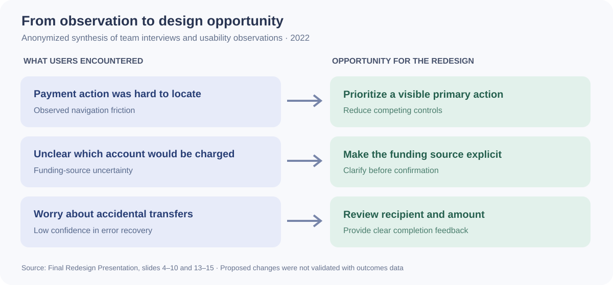

# Payment App Redesign — Making Digital Payments More Accessible

**User-centered design concept · 2022 · Team project**

**Team:** Alexandrea Jee, Cindy Espinosa, Lord Crawford, Naina Durga, Tiffany Chen

## My role & contributions — Tiffany Chen

**My confirmed contributions: User interviews and usability testing.**

I contributed to the team's user research by interviewing participants and observing how they interacted with contactless payment applications. This work helped document usability concerns encountered during account setup and payment tasks.

The findings and proposed redesign below represent the **team's collective work**. I do not claim sole authorship of the interface designs, final recommendations, or any measured improvement.

**Related artifacts:** [Usability Test Plan](../../Seminar%20in%20Human%20Factor%20Design/Usability%20Test%20Plan%20%283-21-2022%29.docx) · [Final team presentation](../../Seminar%20in%20Human%20Factor%20Design/Final%20Redesign%20Presentation.pptx)

## Research evidence: observations and design implications

*Synthesized from the team's 2022 payment-app presentation (slides 4–10 and 13–15); not an individual participant's transcript.*

**My contribution — user interviews and usability testing:** I participated in interviewing users and observing payment-app interactions. The team documented recurring navigation confusion, unclear payment sources, and concerns about accidental transfers. These observations pointed toward clearer primary actions, funding-source visibility, and explicit transaction review as design opportunities.

| Observed usability issue | Design consideration |
| --- | --- |
| Difficulty finding the pay action | Give payment a clear, prominent entry point |
| Uncertainty about payment source | Display the selected source before sending |
| Anxiety about sending money to the wrong person | Show recipient and amount for review |
| Sign-up and verification friction | Make onboarding status and next steps easier to understand |

**Evidence:** [Final team presentation](../../Seminar%20in%20Human%20Factor%20Design/Final%20Redesign%20Presentation.pptx) · [Usability test plan](../../Seminar%20in%20Human%20Factor%20Design/Usability%20Test%20Plan%20%283-21-2022%29.docx)

**Scope of claim:** These were interview and usability observations informing a *proposed* redesign, not measured post-redesign improvements. We are not publishing identifiable interview excerpts in this case study.

## The challenge

How might we reduce confusion, error anxiety, and navigation friction for older adults and people less familiar with contactless payment applications?

The project investigated existing experiences in **Venmo, Zelle, and Cash App** before proposing a simpler payment flow.

## Research and findings

The team documented interview feedback and usability observations. Concerns appearing across the research included:
- Difficulty finding the pay action
- Uncertainty about the funding source
- Risk of paying the wrong person or sending the wrong amount
- Distracting social content and unnecessary controls
- Friction in sign-up and bank verification, especially for users outside the US
- Insufficient transaction confirmation

The research also recognized benefits in existing services, such as Zelle's bank integration and Venmo's payee verification.

## Proposed experience

The team mapped an existing payment flow and explored a redesigned one with:
1. **Home screen:** Search people, scan a QR code, see recent payments
2. **Recipient details:** Review identifying information and transaction history
3. **Payment screen:** Enter an amount with clearer controls
4. **Confirmation:** Check recipient and amount before sending
5. **Success screen:** View completed payment feedback and return home

The direction was intended to simplify the flow while adding visibility and safeguards.

## Design methods

- Competitor comparison and interview synthesis
- Usability observations and task-flow analysis
- Brainstorming and low-fidelity screen sketches
- Discussion of user-centered design and ISO considerations
- Planned prototype walkthroughs with think-aloud testing

[**Read the curated design-process summary →**](design-process.md)

## Evaluation status

The final presentation describes a plan for testing a high-fidelity prototype and future iterative design. **It does not establish that this later validation was completed.** No improvement percentages or measured success rates are claimed here.

## Presentation

[**View the final Payment App Redesign presentation**](../../Seminar%20in%20Human%20Factor%20Design/Final%20Redesign%20Presentation.pptx)

## Selected original research and prototype slides

These original slides come from the team's [Final Redesign Presentation](../../Seminar%20in%20Human%20Factor%20Design/Final%20Redesign%20Presentation.pptx). They connect my verified contribution—user interviews and usability testing—to the broader team's design work.

| Slide | Evidence | Interpretation |
| --- | --- | --- |
| 4 — Venmo interview summary | Reported difficulty finding the pay button, unclear payment sources, and sign-up friction | Interview insights reveal opportunities for clearer navigation and payment information |
| 10 — Existing vs. redesigned flow | Two flows mapped side by side | The team explored changes to payment steps and safeguards |
| 13 — Home/search prototype | Home and contact-search screen concepts | The team's proposed interface makes payment entry points and recent transactions easier to see |
| 15 — Confirmation/success prototype | Confirmation and success-screen concepts | The team's proposed flow includes review and completion feedback |

**My role:** User interviews and usability testing. The interface screens are **team artifacts**, not designs attributed solely to me. These slides do not show a validated improvement in usability or transaction success.

## Supporting project documentation

- [Final Redesign Presentation](../../Seminar%20in%20Human%20Factor%20Design/Final%20Redesign%20Presentation.pptx)
- [Usability Test Plan](../../Seminar%20in%20Human%20Factor%20Design/Usability%20Test%20Plan%20%283-21-2022%29.docx)
- [Redesign — Work in Progress](../../Seminar%20in%20Human%20Factor%20Design/Redesign%20-%20Work%20in%20Progress%20%284-4-2022%29.docx)
- [Gantt Chart](../../Gantt%20Chart.xlsx)

The original interview results document is preserved in the repository but should be reviewed for personally identifying information before promotion to an admissions portfolio.

## Source material

The [final presentation](../../Seminar%20in%20Human%20Factor%20Design/Final%20Redesign%20Presentation.pptx) is available in the project's existing course-materials folder. Additional source material includes interview notes, a usability test plan, a work-in-progress design document, and a Gantt chart. Raw interview notes should not be made public without review and appropriate redaction.

## Credit

This was a five-person collaborative project. Tiffany Chen's confirmed contributions were **user interviews and usability testing**. The research synthesis, prototypes, and design recommendations are attributed to the team unless otherwise documented.
