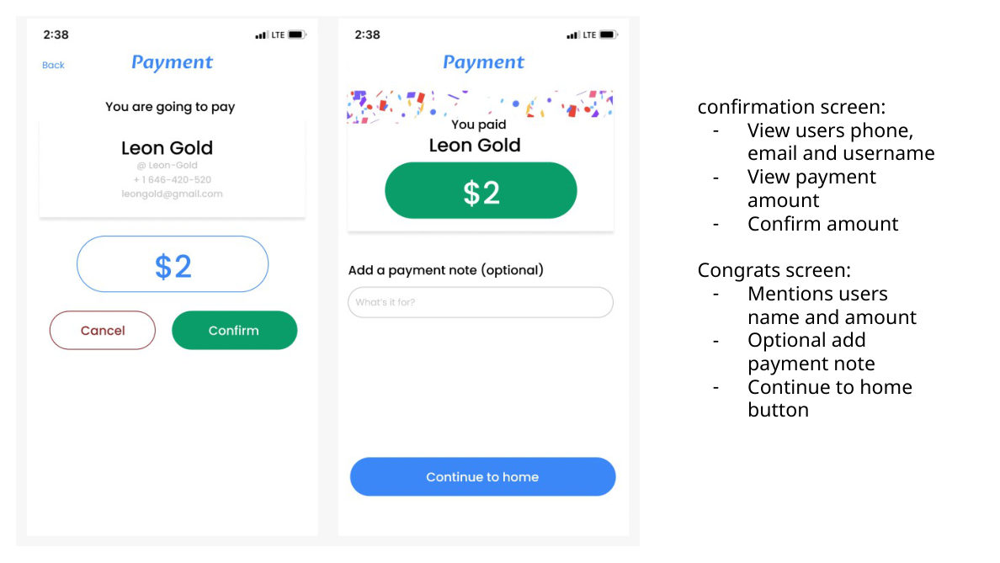

# Payment App Redesign — Making Digital Payments More Accessible

**2022 · User-centered design concept · Collaborative team project**  
**My role:** User interviews and usability testing  
**Team:** Alexandrea Jee, Cindy Espinosa, Lord Crawford, Naina Durga, Tiffany Chen

[View the final team presentation](../../Seminar%20in%20Human%20Factor%20Design/Final%20Redesign%20Presentation.pptx) · [Read the team design-process summary](design-process.md)

## Project overview

**The challenge:** How might we make contactless payment apps easier to navigate and more reassuring for older or less experienced users?

The team examined experiences with **Venmo, Zelle, and Cash App** and proposed a simpler payment flow. Research highlighted uncertainty about funding sources, difficulty locating the Pay action, registration friction, and concern about accidental payments.

## My role and contributions

**I conducted user interviews and usability testing**, gathering observations about how people navigated contactless-payment tasks and where confusion or hesitation occurred.

This contribution supported the team's understanding of user needs. The synthesis and interface prototypes shown below are **team artifacts**, not individual designs I claim to have created.

## Design process

1. **Research — my contribution.** Interview users and observe interactions with existing payment applications.
2. **Synthesize — team work.** Compare usability issues across applications and identify opportunities to reduce confusion.
3. **Explore alternatives — team work.** Map existing and proposed flows, and develop screens emphasizing clearer navigation and transaction review.
4. **Plan evaluation — team work.** Define scenarios for follow-up prototype testing. The materials do not establish completion of post-redesign validation.

[Read the detailed team design-process summary](design-process.md)

## Visual evidence

### 01 · Interview findings

*Readable recreation of slide 4 in the team's [original presentation](../../Seminar%20in%20Human%20Factor%20Design/Final%20Redesign%20Presentation.pptx). The Venmo logo has been repositioned to avoid covering the heading; this is **not an unmodified screenshot**.*

The interview summary includes a useful existing safeguard—last-four-digit payee verification—alongside problems such as an unclear Pay action, distracting social features, complex registration, payment-source ambiguity, and missing confirmation.

### 02 · Connecting observations to design opportunities

| Research observation | Design opportunity |
| --- | --- |
| Difficulty locating the Pay button | Make the primary action easier to find |
| Uncertainty about payment source | Expose the selected funding account before sending |
| Anxiety about sending money incorrectly | Add a clear recipient-and-amount review |
| Registration and verification barriers | Clarify required steps and status |

These are opportunities inferred from the team's findings, **not proven usability improvements**.

### 03 · Existing vs. proposed flow

*The team explored revisions to the steps and safeguards in the payment process.*

### 04 · Home and search concepts

*Collaborative interface concepts exploring discoverability and contact selection.*

### 05 · Confirmation and completion

*Collaborative interface concepts that aim to improve payment certainty, without evidence here of a measured improvement.*

## Outcome and limitations

The team proposed a revised experience with clearer payment entry points, recipient details, amount review, and confirmation feedback. **The available materials describe further usability testing as planned**, so this case study does not claim improved completion rates or validated outcomes.

## Project archive

- [Final Redesign Presentation](../../Seminar%20in%20Human%20Factor%20Design/Final%20Redesign%20Presentation.pptx)
- [Usability Test Plan](../../Seminar%20in%20Human%20Factor%20Design/Usability%20Test%20Plan%20%283-21-2022%29.docx)
- [Redesign — Work in Progress](../../Seminar%20in%20Human%20Factor%20Design/Redesign%20-%20Work%20in%20Progress%20%284-4-2022%29.docx)
- [Gantt Chart](../../Gantt%20Chart.xlsx)

**Privacy and attribution:** Raw interview notes in the repository may identify participants. The above summary uses non-identifying observations; review consent before sharing original interview records.

**Team credit:** Alexandrea Jee, Cindy Espinosa, Lord Crawford, Naina Durga, Tiffany Chen. Tiffany's confirmed contributions: **user interviews and usability testing**.
