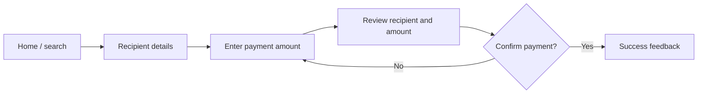

# Payment App Redesign — Research and Design Process

*Source: team's 2022 Final Redesign Presentation, Usability Test Plan, and redesign notes. This summary omits individual interview participant details.*

## Research approach
The team compared Venmo, Zelle, and Cash App using user interviews, task observations, and a review of pain points for older or novice users.

| Research theme | Observed concern | Design implication |
|---|---|---|
| Findability | Users struggled to locate a pay action | Make primary payment actions clear |
| Transaction certainty | Users worried about wrong recipient or amount | Add explicit pre-send confirmation |
| Funding transparency | Some users could not tell which balance/account was used | Clarify the selected funding method |
| Trust | Uncertainty about payment reversibility and status | Provide meaningful review and completion feedback |
| Accessibility | Small buttons and social features caused distraction | Use focused navigation and legible controls |
| Onboarding | Identity and bank verification created friction | Streamline guidance and status explanations |

## Proposed task flow

## Usability scenarios documented
The design materials proposed tasks such as creating an account, connecting a funding source, responding to a friend's payment request, and reviewing transactions.

The final presentation also outlines future high-fidelity prototype testing with think-aloud observations. It should **not** be interpreted as proof that a final prototype was tested or that measured improvements were achieved.

## Team and attribution
This was a team project. The underlying interview notes are not included here because they contain participant-specific details. The team should be credited and individual design contributions described only when verified.
